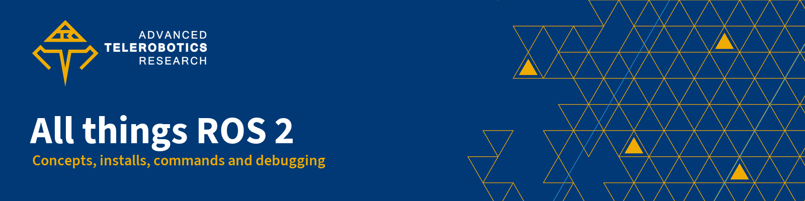

<p align="center">
  
</p>

<p align="center">
  <b>The lab's ROS 2 handbook: what ROS 2 is, which version to use, how to install it, the commands you need and how to fix what breaks, for new students and coding agents.</b><br>
  <sub>Advanced Telerobotics Research Lab · Department of Computer Science · Kent State University</sub>
</p>

<p align="center">
  <a href="LICENSE"></a>
  <a href="https://www.atr.cs.kent.edu/"></a>
  
</p>

## Start here

<table>
  <tr>
    <td width="33%" valign="top">
      <br>
      <b><a href="docs/01-what-is-ros2.md">What is ROS 2</a></b><br>
      <sub>Nodes, topics, services, actions, QoS, discovery, tf2 and workspaces in plain words.</sub>
    </td>
    <td width="33%" valign="top">
      <br>
      <b><a href="docs/02-distributions.md">Distributions</a></b><br>
      <sub>Foxy to Lyrical: dates, end of life and which one to pick.</sub>
    </td>
    <td width="33%" valign="top">
      <br>
      <b><a href="docs/03-install-native.md">Install natively</a></b><br>
      <sub>The official apt install, plus Raspberry Pi, Jetson, macOS and Windows.</sub>
    </td>
  </tr>
  <tr>
    <td width="33%" valign="top">
      <br>
      <b><a href="docs/04-install-rosenv.md">Install with ROSEnv</a></b><br>
      <sub>Several distros side by side in Docker, pinned with a lockfile.</sub>
    </td>
    <td width="33%" valign="top">
      <br>
      <b><a href="docs/05-cheatsheet.md">Command cheatsheet</a></b><br>
      <sub>ros2, colcon, rosdep and environment variables, checked per distro.</sub>
    </td>
    <td width="33%" valign="top">
      <br>
      <b><a href="docs/06-packages-and-nodes.md">Packages and nodes</a></b><br>
      <sub>RViz, bags, ros2_control, Nav2, MoveIt 2, drivers and simulators.</sub>
    </td>
  </tr>
  <tr>
    <td width="33%" valign="top">
      <br>
      <b><a href="docs/07-debugging.md">Debugging</a></b><br>
      <sub>Symptom, cause and fix, from discovery to crashes.</sub>
    </td>
    <td width="33%" valign="top">
      <br>
      <b><a href="docs/08-lab-robots.md">Lab robots</a></b><br>
      <sub>How each lab device connects to ROS 2 and which distro it needs.</sub>
    </td>
    <td width="33%" valign="top">
      <br>
      <b><a href="docs/09-resources.md">Resources</a></b><br>
      <sub>Official docs, REPs, where to ask, courses and lab repos.</sub>
    </td>
  </tr>
</table>

## Which distribution should I use?

**Jazzy on Ubuntu 24.04**, unless something else decides for you. It is supported until May 2029, has the widest set of packages and runs on the lab's newer hardware.

| Your situation | Use |
|---|---|
| New project, nothing forces a version | **Jazzy** (Ubuntu 24.04) |
| Every package you need is released for Lyrical and you want support to 2031 | Lyrical (Ubuntu 26.04) |
| A robot SDK or driver targets it (today: the Unitree Go2 community SDK and the Booster K1 SDK) | Humble (Ubuntu 22.04); ends May 2027, so plan the move |
| Old Foxy, Galactic or Iron code | Run it in that distro's Docker image only |
| Kilted | Not for new work; ends in December 2026 at the latest |

Dates, platforms and the reasoning are in [distributions](docs/02-distributions.md). Status as of Sept. 30, 2026.

## Quick start: five minutes to a talking robot graph

Pick one route. Both end with a talker and a listener exchanging messages.

**Route A: native install** (Ubuntu 24.04; full steps and other distros in [install natively](docs/03-install-native.md))

```bash
sudo apt update && sudo apt install curl software-properties-common -y
sudo add-apt-repository universe
export ROS_APT_SOURCE_VERSION=$(curl -s https://api.github.com/repos/ros-infrastructure/ros-apt-source/releases/latest | grep -F "tag_name" | awk -F'"' '{print $4}')
curl -L -o /tmp/ros2-apt-source.deb "https://github.com/ros-infrastructure/ros-apt-source/releases/download/${ROS_APT_SOURCE_VERSION}/ros2-apt-source_${ROS_APT_SOURCE_VERSION}.$(. /etc/os-release && echo ${UBUNTU_CODENAME:-${VERSION_CODENAME}})_all.deb"
sudo dpkg -i /tmp/ros2-apt-source.deb
sudo apt update && sudo apt upgrade -y
sudo apt install ros-jazzy-desktop ros-dev-tools -y
source /opt/ros/jazzy/setup.bash
ros2 run demo_nodes_cpp talker   # second terminal: source the same file, then ros2 run demo_nodes_py listener
```

**Route B: ROSEnv** (a Linux host with Python 3.11+ and Docker Engine, tested on Ubuntu 24.04; ROS is not installed into the system; details in [install with ROSEnv](docs/04-install-rosenv.md))

```bash
git clone https://github.com/MarcoDotIO/rosenv.git && cd rosenv && uv tool install . && cd ..
mkdir -p ~/robot_ws/src && cd ~/robot_ws
rosenv init --ros jazzy
rosenv add demo_nodes_cpp
rosenv run -- ros2 run demo_nodes_cpp talker     # in a second terminal: rosenv run -- ros2 run demo_nodes_cpp listener
```

Then build and test a real package: the [example workspace](examples/README.md) has a talker and listener with parameters, a launch file and tests, verified on Humble, Jazzy, Kilted and Lyrical.

## Repo map

| Path | What it holds | Read it when |
|---|---|---|
| [`docs/`](docs/README.md) | The handbook, nine numbered pages | You are learning ROS 2 or looking something up |
| [`docs/01-what-is-ros2.md`](docs/01-what-is-ros2.md) | Concepts and vocabulary | You are new to ROS |
| [`docs/02-distributions.md`](docs/02-distributions.md) | Every distro from Foxy to Lyrical, and a decision guide | You are choosing a version or migrating |
| [`docs/03-install-native.md`](docs/03-install-native.md) | Official installs and platform notes | You are setting up a computer or robot |
| [`docs/04-install-rosenv.md`](docs/04-install-rosenv.md) | ROSEnv environments and lockfiles | You need several distros or reproducible dependencies |
| [`docs/05-cheatsheet.md`](docs/05-cheatsheet.md) | Commands and environment variables | You need an exact command |
| [`docs/06-packages-and-nodes.md`](docs/06-packages-and-nodes.md) | Useful packages by task | You need a tool for a job |
| [`docs/07-debugging.md`](docs/07-debugging.md) | Symptoms, causes, fixes | Something does not work |
| [`docs/08-lab-robots.md`](docs/08-lab-robots.md) | Lab devices and their ROS 2 support | You are writing code for a lab robot |
| [`docs/09-resources.md`](docs/09-resources.md) | External links | You need more depth |
| [`examples/`](examples/README.md) | `hello_ws`, a tested example workspace | You want working code to copy |
| [`AGENTS.md`](AGENTS.md) | Rules, sources and checks for coding agents and contributors | You are editing this repo |

## Contributing

Found something wrong or out of date? [Open an issue](https://github.com/ATR-Lab/all-things-ros2/issues) or send a pull request. Follow the writing rules and checks in [AGENTS.md](AGENTS.md): cite an official source for every version, date or command, run the command before you document it, and use `[bracketed placeholders]` for anything only the lab can confirm.

## License

Text and code in this repository are released under the [MIT License](LICENSE). The names and logos of the Advanced Telerobotics Research Lab and Kent State University are trademarks and are not covered by that license. ROS, ROS 2 and the distribution names and logos belong to their respective owners; third-party projects linked from these pages keep their own licenses.

---

<p align="center">
  <sub><b>ATR Lab docs</b> ·
  <a href="https://github.com/ATR-Lab/about">About the lab</a> ·
  <a href="https://github.com/ATR-Lab/getting-started-atr-lab">Getting started</a> ·
  <a href="https://github.com/ATR-Lab/dev-guidelines">Dev guidelines</a> ·
  <a href="https://github.com/ATR-Lab/all-things-ros2">All things ROS 2</a> ·
  <a href="https://github.com/ATR-Lab">All repositories</a></sub><br>
  <sub>Advanced Telerobotics Research Lab · Department of Computer Science · Kent State University ·
  <a href="https://www.atr.cs.kent.edu/">www.atr.cs.kent.edu</a></sub>
</p>
