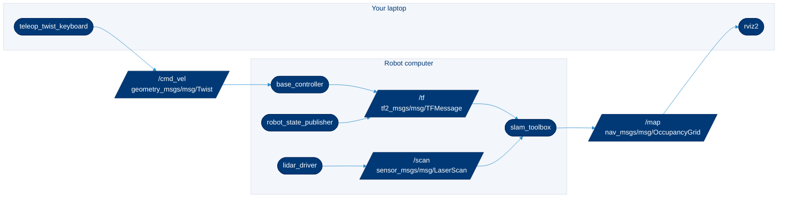

# What is ROS 2

> **Read this when** you are new to ROS and want the mental model before you install anything or read someone else's robot code.

ROS 2 (Robot Operating System 2) is not an operating system. It is a set of open-source libraries and tools that let small programs on one or many computers find each other and exchange data, plus a large catalog of ready-made packages for robots. This page explains the pieces you will meet in your first week: the graph of nodes and topics, the build tools and how discovery on a network works. The one thing to remember: **everything in ROS 2 is a node talking over named channels, and you inspect all of it with the `ros2` command.**

## Contents

- [The ROS graph](#the-ros-graph)
- [Nodes](#nodes)
- [Topics](#topics)
- [Services](#services)
- [Actions](#actions)
- [Parameters](#parameters)
- [Launch files](#launch-files)
- [Interfaces: msg, srv and action](#interfaces-msg-srv-and-action)
- [Middleware: DDS, RMW and Zenoh](#middleware-dds-rmw-and-zenoh)
- [Quality of service (QoS)](#quality-of-service-qos)
- [Discovery and ROS\_DOMAIN\_ID](#discovery-and-ros_domain_id)
- [tf2: coordinate frames](#tf2-coordinate-frames)
- [Workspaces, underlays and overlays](#workspaces-underlays-and-overlays)
- [Build tools: colcon, ament and rosdep](#build-tools-colcon-ament-and-rosdep)
- [Glossary](#glossary)

## The ROS graph

A running ROS 2 system is a **graph**: nodes (programs) connected by topics, services and actions. The diagram shows a small mobile robot with a lidar (a laser scanner that measures distances), a drive base and a laptop running visualization and teleoperation (controlling the robot from a distance).



Rounded boxes are nodes; slanted boxes are topics with their message types. Every arrow is a publish or subscribe: the lidar driver publishes `/scan`, `slam_toolbox` subscribes to it and to `/tf` and publishes `/map`, and RViz on the laptop subscribes to `/map`. Both computers use the same `ROS_DOMAIN_ID`, so they see one graph. You can draw the live version of this graph for any running system with `rqt_graph` ([packages and nodes](06-packages-and-nodes.md#visualization)).

## Nodes

A **node** is one program (or one object inside a program) that does one job: read a sensor, plan a path, drive the motors. Nodes are written with a client library, usually `rclcpp` (C++) or `rclpy` (Python). Small, single-purpose nodes are easier to test and reuse.

```bash
ros2 node list                 # every node on the network
ros2 node info /talker         # its topics, services and actions
```

Official concept page: [Nodes](https://docs.ros.org/en/jazzy/Concepts/Basic/About-Nodes.html).

## Topics

A **topic** is a named, typed stream of messages. Publishers send; any number of subscribers receive; neither side knows who is on the other end. Use topics for continuous data: sensor readings, velocity commands, robot state.

```bash
ros2 topic list -t             # names and types
ros2 topic echo /chatter       # print messages as they arrive
ros2 topic hz /scan            # measured publish rate
```

Official concept page: [Topics](https://docs.ros.org/en/jazzy/Concepts/Basic/About-Topics.html).

## Services

A **service** is a request and a response, like a function call over the network. Use it for quick queries or commands that finish fast ("reset the odometry", "what is parameter X?"). Do not use a service for anything that takes seconds; use an action.

```bash
ros2 service list -t
ros2 service call /talker/get_parameters rcl_interfaces/srv/GetParameters "{names: ['greeting']}"
```

Official concept page: [Services](https://docs.ros.org/en/jazzy/Concepts/Basic/About-Services.html).

## Actions

An **action** is a long-running goal with feedback and the option to cancel: "drive to the kitchen", "move the arm to this pose". Under the hood it is built from topics and services. Navigation (Nav2) and motion planning (MoveIt 2) expose actions.

```bash
ros2 action list -t
# Needs turtlesim running (ros2 run turtlesim turtlesim_node); the example is from the official tutorial
ros2 action send_goal /turtle1/rotate_absolute turtlesim/action/RotateAbsolute "{theta: 1.57}" --feedback
```

Official concept page: [Actions](https://docs.ros.org/en/jazzy/Concepts/Basic/About-Actions.html).

## Parameters

A **parameter** is a named setting that belongs to one node (a speed limit, a frame name, a file path). Nodes declare parameters with defaults; you override them on the command line, in a YAML file or from a launch file, and many nodes accept changes while running.

```bash
ros2 run hello_atr talker --ros-args -p greeting:="Hi" -p publish_rate_hz:=5.0
ros2 param list /talker
ros2 param set /talker greeting "Changed at runtime"
ros2 param dump /talker        # prints YAML you can save and reuse
```

Official concept page: [Parameters](https://docs.ros.org/en/jazzy/Concepts/Basic/About-Parameters.html). The [example workspace](../examples/hello_ws/) shows a node that declares and reads parameters.

## Launch files

A **launch file** starts many nodes at once with their parameters, remappings (renamed topics) and namespaces. Launch files can be Python (`.launch.py`), XML or YAML. A real robot is almost always started with `ros2 launch`, not a pile of terminals.

```bash
ros2 launch hello_atr hello_atr.launch.py greeting:='Hi from the lab'
ros2 launch --show-args hello_atr hello_atr.launch.py   # list the arguments a launch file accepts
```

Official concept page: [Launch](https://docs.ros.org/en/jazzy/Concepts/Basic/About-Launch.html).

## Interfaces: msg, srv and action

An **interface** is the data type on a channel, defined in a small text file:

| File | Used by | Example |
|---|---|---|
| `.msg` | Topics | `geometry_msgs/msg/Twist`: linear and angular velocity |
| `.srv` | Services | `std_srvs/srv/Trigger`: empty request, success flag and message in the response |
| `.action` | Actions | `nav2_msgs/action/NavigateToPose`: goal pose, feedback, result |

Use the standard types (`std_msgs`, `geometry_msgs`, `sensor_msgs`, `nav_msgs`) whenever they fit, so other packages can read your data. Define your own only when nothing standard fits.

```bash
ros2 interface show geometry_msgs/msg/Twist
ros2 interface proto geometry_msgs/msg/Twist     # a YAML template to paste into `ros2 topic pub`
```

Official concept page: [Interfaces](https://docs.ros.org/en/jazzy/Concepts/Basic/About-Interfaces.html).

## Middleware: DDS, RMW and Zenoh

ROS 2 does not move bytes itself. It hands them to a **middleware** through a thin layer called the **RMW** (ROS middleware interface). Most RMW implementations use **DDS** (Data Distribution Service, an industry standard for publish-subscribe networking); `rmw_zenoh_cpp` uses Eclipse Zenoh instead. You can swap the RMW at run time with the `RMW_IMPLEMENTATION` environment variable, but every node in a system should use the same one: [cross-vendor communication is not guaranteed](https://docs.ros.org/en/jazzy/Concepts/Intermediate/About-Different-Middleware-Vendors.html).

| Distribution | Default RMW | Source |
|---|---|---|
| Foxy | `rmw_fastrtps_cpp` (eProsima Fast DDS) | [REP 2000](https://reps.openrobotics.org/rep-2000/) |
| Galactic | `rmw_cyclonedds_cpp` (Eclipse Cyclone DDS) | [REP 2000](https://reps.openrobotics.org/rep-2000/) |
| Humble, Iron, Jazzy, Kilted | `rmw_fastrtps_cpp` | [REP 2000](https://reps.openrobotics.org/rep-2000/) |
| Lyrical | `rmw_fastrtps_cpp` | [Lyrical supported platforms](https://docs.ros.org/en/lyrical/Releases/lyrical/supported-platforms.html) |

`rmw_zenoh_cpp` became a Tier 1 middleware in Kilted ([Kilted release notes](https://docs.ros.org/en/lyrical/Releases/Release-Kilted-Kaiju.html)). We checked the default with `ros2 doctor --report` in the official `ros:humble`, `ros:jazzy`, `ros:kilted` and `ros:lyrical` images: all four report `rmw_fastrtps_cpp`.

## Quality of service (QoS)

**QoS** settings describe how a topic delivers data. The ones you will touch:

| Policy | Options | Plain meaning |
|---|---|---|
| Reliability | `reliable`, `best_effort` | Retry lost messages, or drop them to stay fast |
| Durability | `volatile`, `transient_local` | New subscribers get nothing old, or get the last messages kept by the publisher (used for `/map` and `/robot_description`) |
| History and depth | `keep_last` N, `keep_all` | How many messages to queue |

A publisher and a subscriber connect only if their QoS is **compatible**. The classic trap: a sensor driver publishes `best_effort` and your subscriber asks for `reliable`, so you receive nothing. ROS 2 warns you (`offering incompatible QoS. No messages will be received from it`); [debugging](07-debugging.md#qos-mismatch-subscriber-receives-nothing) shows how to spot and fix it. Official concept page: [Quality of service settings](https://docs.ros.org/en/jazzy/Concepts/Intermediate/About-Quality-of-Service-Settings.html).

## Discovery and ROS\_DOMAIN\_ID

Nodes find each other automatically: there is no central master as in ROS 1. With the default DDS middleware, nodes announce themselves with multicast on the local network.

- **`ROS_DOMAIN_ID`** splits one physical network into separate ROS networks. Nodes with different domain IDs cannot see each other. The default is 0. The ROS docs say to pick a number from 0 to 101 on Linux to stay clear of the operating system's ephemeral ports ([About domain ID](https://docs.ros.org/en/jazzy/Concepts/Intermediate/About-Domain-ID.html)). In a shared lab, give every robot and its operator the same unique number: `[lab domain ID assignments]`.
- **`ROS_AUTOMATIC_DISCOVERY_RANGE`** (Iron and later) limits how far discovery reaches: `SUBNET` (default), `LOCALHOST`, `OFF` or `SYSTEM_DEFAULT`. **`ROS_STATIC_PEERS`** adds specific machines by address. Humble uses the older `ROS_LOCALHOST_ONLY=1` instead; see the [cheatsheet](05-cheatsheet.md#environment-variables) for which distribution reads which variable.

> [!IMPORTANT]
> A domain ID prevents accidental crosstalk. It is not security: anyone on the same network who picks your number can see and command your robot.

## tf2: coordinate frames

A robot has many coordinate frames: `map`, `odom`, `base_link`, `laser`, `camera_link`, one for each arm joint. **tf2** keeps a time-stamped tree of how each frame relates to its parent, so any node can ask "where was the laser relative to the map 50 ms ago?". Fixed offsets (a camera bolted to the chassis) come from a URDF robot model via `robot_state_publisher` or from `static_transform_publisher`; moving ones come from odometry, localization and joint states.

```bash
ros2 run tf2_ros tf2_echo base_link camera_link    # print one transform
ros2 run tf2_tools view_frames                     # write the whole tree to frames_<date>.pdf
```

Official concept page: [tf2](https://docs.ros.org/en/jazzy/Concepts/Intermediate/About-Tf2.html). Frame names and axis conventions follow [REP 105](https://reps.openrobotics.org/rep-0105/) and [REP 103](https://reps.openrobotics.org/rep-0103/).

## Workspaces, underlays and overlays

A **workspace** is a folder with your packages in `src/`. Building it creates `build/`, `install/` and `log/` next to `src/`.

```text
hello_ws/
├── src/          your packages (commit this)
├── build/        intermediate files (never commit)
├── install/      built packages and setup scripts (never commit)
└── log/          build and test logs (never commit)
```

Workspaces stack. The ROS installation in `/opt/ros/<distro>` is the **underlay**; your workspace, built on top of it, is an **overlay**. Source them in that order:

```bash
source /opt/ros/jazzy/setup.bash      # underlay: the ROS installation
source ~/hello_ws/install/setup.bash  # overlay: your packages, which take priority
```

A package in the overlay hides the package of the same name in the underlay. That is how you patch a released package: clone its source into your workspace and rebuild. Official tutorial: [Creating a workspace](https://docs.ros.org/en/jazzy/Tutorials/Beginner-Client-Libraries/Creating-A-Workspace/Creating-A-Workspace.html).

## Build tools: colcon, ament and rosdep

| Tool | Job | You run |
|---|---|---|
| **colcon** | Builds and tests every package in a workspace in dependency order | `colcon build`, `colcon test` |
| **ament** | The build system inside each package: `ament_cmake` for C++ (and mixed) packages, `ament_python` for pure Python | Nothing directly; you pick it in `package.xml` |
| **rosdep** | Reads each `package.xml` and installs the system packages it needs | `rosdep install --from-paths src --ignore-src -y` |
| **package.xml** | The package manifest: name, version, license, dependencies | You edit it |

The full commands with their flags are in the [cheatsheet](05-cheatsheet.md#colcon). Official pages: [About the build system](https://docs.ros.org/en/jazzy/Concepts/Advanced/About-Build-System.html), [colcon tutorial](https://docs.ros.org/en/jazzy/Tutorials/Beginner-Client-Libraries/Colcon-Tutorial.html), [rosdep](https://docs.ros.org/en/jazzy/Tutorials/Intermediate/Rosdep.html).

## Glossary

| Term | Plain meaning |
|---|---|
| Distribution (distro) | A dated, versioned set of ROS 2 packages, such as Jazzy or Lyrical ([distributions](02-distributions.md)) |
| Package | The unit you build, share and install: code plus a `package.xml` |
| Node | One running program with one job |
| Topic | A named stream of messages, many-to-many |
| Service | A request and a response |
| Action | A long goal with feedback and cancel |
| Parameter | A named setting of one node |
| Interface | A message, service or action type |
| Launch file | A script that starts and configures many nodes |
| RMW | The layer that plugs a middleware (DDS or Zenoh) into ROS 2 |
| QoS | Delivery rules for a topic: reliability, durability, depth |
| Domain ID | A number that separates ROS networks on one physical network |
| tf2 | The library that tracks coordinate frames over time |
| URDF | An XML description of a robot's links and joints |
| Underlay, overlay | The workspace you build on, and the workspace you build |
| Sourcing | Running a `setup.bash` so your shell can find ROS packages |

## Related

- [Distributions and which to choose](02-distributions.md)
- [Install ROS 2 natively](03-install-native.md) or [with ROSEnv](04-install-rosenv.md)
- [Command cheatsheet](05-cheatsheet.md)
- [Example workspace](../examples/hello_ws/): a node with a topic, a parameter, a launch file and a test
- Official: [ROS 2 concepts](https://docs.ros.org/en/jazzy/Concepts.html) and [tutorials](https://docs.ros.org/en/jazzy/Tutorials.html)
- Lab conventions for ROS 2 packages: [dev-guidelines: ROS 2 packages](https://github.com/ATR-Lab/dev-guidelines/blob/master/docs/ros2-packages.md)

<sub>Last reviewed: Sept. 30, 2026 · Sources checked on that date · [Suggest a change](https://github.com/ATR-Lab/all-things-ros2/edit/main/docs/01-what-is-ros2.md)</sub>
