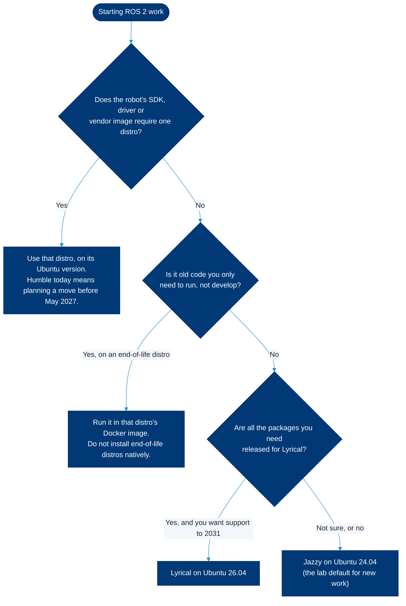

# ROS 2 distributions and which to choose

> **Read this when** you have to pick a ROS 2 version for a new project, a robot or a lab computer, or you inherited code and need to know whether its distribution is still supported.

A ROS 2 **distribution** (distro) is a dated, versioned set of packages that stays stable for its support window, much like an Ubuntu release. Each distro is tied to one Ubuntu LTS version, and code built for one distro is not guaranteed to talk to nodes built for another. This page lists every distro from Foxy to Lyrical plus Rolling, with dates and platforms checked on Sept. 30, 2026, then gives the lab's decision guide. The one thing to remember: **pick the distro first, and the Ubuntu version follows from it.**

## Contents

- [All distributions at a glance](#all-distributions-at-a-glance)
- [How support works: LTS and non-LTS](#how-support-works-lts-and-non-lts)
- [Which distribution should I use?](#which-distribution-should-i-use)
- [Distribution details](#distribution-details)
- [Migrating between distributions](#migrating-between-distributions)
- [Related](#related)

## All distributions at a glance

Status is as of **Sept. 30, 2026**. "Tier 1" means the ROS 2 project builds, tests and ships binary packages for that platform ([platform support tiers](https://docs.ros.org/en/jazzy/The-ROS2-Project/Platform-Support-Tiers.html)).

| Distribution | Released | End of life | LTS | Tier 1 platforms | Status today |
|---|---|---|---|---|---|
| **Lyrical Luth** (`lyrical`) | May 22, 2026 | May 2031 | Yes | Ubuntu 26.04 (amd64, arm64; deb packages); Windows 11 (amd64; binary archive) | Supported; newest LTS |
| **Kilted Kaiju** (`kilted`) | May 23, 2025 | December 2026 (REP 2000 plans November 2026) | No | Ubuntu 24.04 (amd64, arm64); Windows 10 (amd64) | Supported for about three more months; do not start new work |
| **Jazzy Jalisco** (`jazzy`) | May 23, 2024 | May 2029 | Yes | Ubuntu 24.04 (amd64, arm64); Windows 10 (amd64) | Supported; widest package coverage |
| **Iron Irwini** (`iron`) | May 23, 2023 | Dec. 4, 2024 | No | Ubuntu 22.04 (amd64, arm64); Windows 10 (amd64) | End of life |
| **Humble Hawksbill** (`humble`) | May 23, 2022 | May 2027 | Yes | Ubuntu 22.04 (amd64, arm64); Windows 10 (amd64) | Supported for about eight more months |
| **Galactic Geochelone** (`galactic`) | May 23, 2021 | Dec. 9, 2022 | No | Ubuntu 20.04 (amd64, arm64); Windows 10 (amd64) | End of life |
| **Foxy Fitzroy** (`foxy`) | June 5, 2020 | June 20, 2023 | Yes (three-year window) | Ubuntu 20.04 (amd64, arm64); macOS Mojave 10.14 and Windows 10 (amd64; binary archives) | End of life |
| **Rolling Ridley** (`rolling`) | June 2020, continuous | None | Not applicable | Ubuntu 26.04 today; moves as new platforms are chosen | Development distribution; can break in place |

Sources: release and end-of-life dates from the [ROS 2 distributions page](https://docs.ros.org/en/lyrical/Releases.html); platforms for Foxy through Kilted from [REP 2000](https://reps.openrobotics.org/rep-2000/); Lyrical platforms from the [Lyrical supported platforms page](https://docs.ros.org/en/lyrical/Releases/lyrical/supported-platforms.html) (REP 2000 had not added Lyrical when we checked); Rolling's platform from its [Ubuntu install page](https://docs.ros.org/en/rolling/Get-Started/Installation/Ubuntu-Install-Debs.html); Foxy's three-year LTS from the [Open Robotics release post](https://www.openrobotics.org/blog/2020/6/5/ros-2-foxy-fitzroy-release).

> [!NOTE]
> Two official sources disagree on Kilted: the distributions page says it ends in **December 2026**, while REP 2000's heading says **November 2026**. Plan for November. The next distribution, Makoa Mata-mata, is planned for May 2027 with an end of life in December 2028, according to the same distributions page.

The Ubuntu versions have their own clocks: standard support for Ubuntu 20.04 ended in May 2025, 22.04 ends in May 2027, 24.04 in May 2029 and 26.04 in May 2031 ([Ubuntu release cycle](https://ubuntu.com/about/release-cycle)).

## How support works: LTS and non-LTS

[REP 2000](https://reps.openrobotics.org/rep-2000/) sets the rhythm. A new distro ships every May. In **even years** it is an **LTS** (long-term support) release, supported for about five years to match its Ubuntu LTS. In **odd years** it is a non-LTS release supported for 1.5 years, built on the same Ubuntu as the previous LTS. Foxy (2020) came before this policy and had a three-year LTS window.

What end of life means in practice:

- No more bug fixes, security fixes or new package releases. The build farm stops building it.
- The last binaries may linger. On Sept. 30, 2026 the main ROS apt repository still carried frozen Foxy and Galactic packages for Ubuntu 20.04 and Iron packages for Ubuntu 22.04 (we counted them in `packages.ros.org/ros2/ubuntu`), and [snapshots.ros.org](http://snapshots.ros.org/) keeps a `final` snapshot for each. Nothing promises they stay.
- Docker images stop updating. `ros:foxy`, `ros:galactic` and `ros:iron` still pull from Docker Hub, but they were last rebuilt in June 2025 and are no longer in the [official image list](https://github.com/docker-library/official-images/blob/master/library/ros).

Nodes from different distros are [not guaranteed to communicate](https://docs.ros.org/en/lyrical/Releases.html), so a robot and the laptop that controls it should run the same distro.

## Which distribution should I use?

**The lab rule** (decided Nov. 2026): manage ROS 2 with [ROSEnv](04-install-rosenv.md), which runs several distributions side by side on one machine, and use the distribution the robot's SDK was written for. The list below covers everything else.

**Our recommendation for fall 2026:**

1. **New projects: Jazzy on Ubuntu 24.04.** It is an LTS supported until May 2029, it has the widest set of released packages, and it is the Tier 1 distro for the hardware the lab is adding: NVIDIA JetPack 7 on the Jetson AGX Thor is based on Ubuntu 24.04, and Ubuntu 24.04 is the first LTS that supports the Raspberry Pi 5 ([lab robots](08-lab-robots.md)).
2. **Choose Lyrical on Ubuntu 26.04** when every package you need has a Lyrical release and you want the longest runway (May 2031). Check first: four months after release, some drivers and tools still had no Lyrical binaries, and several vendor stacks (NVIDIA Isaac Sim, micro-ROS setup tools) did not list Lyrical yet ([packages and nodes](06-packages-and-nodes.md#availability-gaps-on-lyrical)). NVIDIA Isaac ROS 5.0 is the exception: it moved to Lyrical in September 2026.
3. **Use Humble only when something pins it**, such as a robot SDK, a vendor image or a community driver that targets it (today the Unitree Go2 community SDK is tested on Humble and the Booster K1 SDK is built for Ubuntu 22.04). Humble ends in May 2027, so treat every Humble project as one that must migrate soon; the lab plans to fork the Go2 and K1 SDKs for Lyrical ([lab robots](08-lab-robots.md#moving-off-humble)).
4. **Do not start new work on Kilted.** It ends in December 2026 at the latest.
5. **Use Rolling only to develop ROS 2 itself** or to test against the next release. It can change under you.
6. **Run end-of-life distros (Foxy, Galactic, Iron) only in Docker**, only to run existing code, and plan a port. [Install natively](03-install-native.md#end-of-life-distributions-iron-galactic-foxy) explains the options.

> [!TIP]
> Not sure a package exists for your distro? Search [ROS Index](https://index.ros.org/) or ask apt directly on a machine with the ROS repository set up: `apt-cache policy ros-jazzy-navigation2`.

## Distribution details

### Lyrical Luth (LTS, 2026 to 2031)

The twelfth ROS 2 release and the newest LTS. It targets Ubuntu 26.04 with Tier 1 deb packages for amd64 and arm64, a Windows 11 binary archive and Tier 2 RPMs for RHEL 10; Ubuntu 24.04 is only Tier 3 (build from source) for Lyrical. Minimum C++ is C++20 and Python is 3.12 to 3.14; on Ubuntu 26.04 it builds against Qt 6, so RViz and rqt plugins written for Qt 5 need porting. Highlights include a callback-group events executor, an `asyncio`-friendly `AsyncNode` in `rclpy`, `ros2 service info --verbose` and `ros2 topic bw` for several topics at once. Pairs with Gazebo Jetty. [Release notes](https://docs.ros.org/en/lyrical/Releases/Release-Lyrical-Luth.html) · [supported platforms](https://docs.ros.org/en/lyrical/Releases/lyrical/supported-platforms.html) · [install](https://docs.ros.org/en/lyrical/Get-Started/Installation/Ubuntu-Install-Debs.html).

### Kilted Kaiju (non-LTS, 2025 to 2026)

Ubuntu 24.04, same as Jazzy. Made `rmw_zenoh_cpp` a Tier 1 middleware, removed the deprecated `ROS_LOCALHOST_ONLY` variable and deprecated the CMake macro `ament_target_dependencies()`. Pairs with Gazebo Ionic, which also ends in December 2026 ([Gazebo releases](https://gazebosim.org/docs/latest/releases/)). [Release notes](https://docs.ros.org/en/lyrical/Releases/Release-Kilted-Kaiju.html) · [install](https://docs.ros.org/en/kilted/Installation/Ubuntu-Install-Debs.html).

### Jazzy Jalisco (LTS, 2024 to 2029)

Ubuntu 24.04 with Python 3.12. The recommended default for new lab work. Default bag format is MCAP; `ros2 bag record` prefers `--topics` over positional topic names. Pairs with Gazebo Harmonic. [Release notes](https://docs.ros.org/en/lyrical/Releases/Release-Jazzy-Jalisco.html) · [install](https://docs.ros.org/en/jazzy/Installation/Ubuntu-Install-Debs.html).

### Humble Hawksbill (LTS, 2022 to 2027)

Ubuntu 22.04 with Python 3.10. Many robot vendor SDKs and community drivers still target it, which is why much existing lab code uses it. Uses `ROS_LOCALHOST_ONLY` (it does not read `ROS_AUTOMATIC_DISCOVERY_RANGE`), records bags as SQLite by default and pairs with Gazebo Fortress. [Release notes](https://docs.ros.org/en/lyrical/Releases/Release-Humble-Hawksbill.html) · [install](https://docs.ros.org/en/humble/Installation/Ubuntu-Install-Debs.html).

End-of-life distributions: Iron, Galactic and Foxy

**Iron Irwini** (non-LTS, May 23, 2023 to Dec. 4, 2024). Ubuntu 22.04. Introduced `ROS_AUTOMATIC_DISCOVERY_RANGE` and `ROS_STATIC_PEERS` and made MCAP the default bag format. [Release notes](https://docs.ros.org/en/lyrical/Releases/Release-Iron-Irwini.html).

**Galactic Geochelone** (non-LTS, May 23, 2021 to Dec. 9, 2022). Ubuntu 20.04. The only distro from Foxy on whose default middleware was Cyclone DDS (the others use Fast DDS). [Release notes](https://docs.ros.org/en/lyrical/Releases/Release-Galactic-Geochelone.html).

**Foxy Fitzroy** (LTS, June 5, 2020 to June 20, 2023). Ubuntu 20.04. The first ROS 2 release with a three-year support window, and still the distro in some vendor images, including Yahboom's ROS 2 Docker image for the ROSMASTER X3 and the examples in Unitree's official `unitree_ros2` ([lab robots](08-lab-robots.md)). [Release notes](https://docs.ros.org/en/lyrical/Releases/Release-Foxy-Fitzroy.html).

Older releases (Ardent through Eloquent) are listed on the [distributions page](https://docs.ros.org/en/lyrical/Releases.html). Nothing in the lab should need them.

## Migrating between distributions

Moving a workspace to a newer distro is mostly a rebuild, plus a short list of known changes. Work through it on a branch:

- [ ] Read the "Changes since the previous release" section of every release page between your old and new distro ([Iron](https://docs.ros.org/en/lyrical/Releases/Release-Iron-Irwini.html), [Jazzy](https://docs.ros.org/en/lyrical/Releases/Release-Jazzy-Jalisco.html), [Kilted](https://docs.ros.org/en/lyrical/Releases/Release-Kilted-Kaiju.html), [Lyrical](https://docs.ros.org/en/lyrical/Releases/Release-Lyrical-Luth.html)).
- [ ] Move to the new Ubuntu version first (or a container of it), then install the new distro. Never mix two distros in one shell.
- [ ] Delete `build/`, `install/` and `log/`, run `rosdep install --from-paths src --ignore-src -y`, then `colcon build`.
- [ ] Check that every dependency has a release for the new distro (`apt-cache policy ros-<distro>-<package>`). Missing ones must be built from source in your workspace.
- [ ] Fix compiler and deprecation warnings before they become errors in the next release.

Known changes that catch lab code:

| Change | Affects | What to do |
|---|---|---|
| Ubuntu 24.04 blocks `pip install` into the system Python (`externally-managed-environment`) | Humble → Jazzy | Prefer apt packages (`python3-<name>`) and `rosdep`; use a virtual environment for anything else |
| `ROS_LOCALHOST_ONLY` deprecated in Iron, removed in Kilted | Humble → anything newer | Use `ROS_AUTOMATIC_DISCOVERY_RANGE=LOCALHOST` ([cheatsheet](05-cheatsheet.md#environment-variables)) |
| MCAP became the default bag format (Iron) | Humble → newer | Old `.db3` bags still play; `ros2 bag convert` rewrites them |
| `ros2 bag record /topic` positional names deprecated (Jazzy), removed (Lyrical) | Scripts | Use `ros2 bag record --topics /a /b` |
| `static_transform_publisher` positional arguments deprecated (Humble), removed (Lyrical) | Launch files | Use `--x --y --z --roll --pitch --yaw --frame-id --child-frame-id` |
| `diff_drive_controller` requires `geometry_msgs/msg/TwistStamped` on `cmd_vel` ([ros2_controllers migration](https://control.ros.org/jazzy/doc/ros2_controllers/doc/migration.html)) | ros2_control on Jazzy and newer | Publish stamped twists; `teleop_twist_keyboard` has a `stamped` parameter |
| Gazebo Classic reached end of life in January 2025 ([classic.gazebosim.org](https://classic.gazebosim.org/)); each distro pairs with a newer Gazebo | Simulation | Humble ↔ Fortress, Jazzy ↔ Harmonic, Kilted ↔ Ionic, Lyrical ↔ Jetty ([Gazebo and ROS](https://gazebosim.org/docs/latest/ros_installation/)) |
| `ament_target_dependencies()` deprecated (Kilted) | C++ packages | Use `target_link_libraries()` with the package's CMake targets |
| C++20 minimum and Qt 6 on Ubuntu 26.04 (Lyrical) | C++ and GUI plugins | Build with a C++20 compiler; port Qt 5 RViz and rqt plugins |

## Related

- [What is ROS 2](01-what-is-ros2.md)
- [Install natively](03-install-native.md), including end-of-life options, or [with ROSEnv](04-install-rosenv.md)
- [Lab robots and their distros](08-lab-robots.md)
- Official: [ROS 2 distributions](https://docs.ros.org/en/lyrical/Releases.html), [REP 2000](https://reps.openrobotics.org/rep-2000/), [end-of-life distributions](https://docs.ros.org/en/lyrical/Releases/End-of-Life.html)

Last reviewed: Nov. 4, 2026 · Sources checked Sept. 30, 2026 · [Suggest a change](https://github.com/ATR-Lab/all-things-ros2/edit/main/docs/02-distributions.md)
