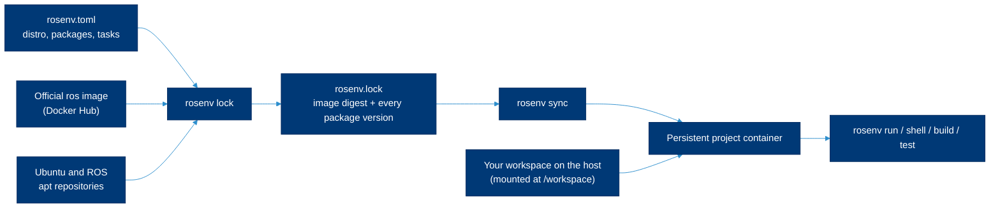

# Install ROS 2 with ROSEnv

> **Read this when** you want ROS 2 on a Linux machine without installing it into the system, need two distributions side by side, or want a project whose ROS dependencies are pinned in a lockfile.

[ROSEnv](https://github.com/MarcoDotIO/rosenv) (command: `rosenv`) is an open-source ROS 2 project and dependency manager written by a lab member. You declare a distribution and packages in `rosenv.toml`; ROSEnv resolves them into `rosenv.lock` and runs your workspace inside a persistent Docker container built from the official ROS image, with your source folder mounted from the host. This page covers what it needs, how to install it, the everyday commands and its current limits, from its README and docs as of Sept. 30, 2026 (version 0.2.0, MIT license). The one thing to remember: **ROSEnv manages ROS userspace in Docker on a Linux or macOS host; it has no GPU or screen access and reaches only the devices you declare**, so it is for development and testing, not for driving hardware.

## Contents

- [When to use ROSEnv, native or plain Docker](#when-to-use-rosenv-native-or-plain-docker)
- [How it works](#how-it-works)
- [Requirements](#requirements)
- [Install](#install)
- [Quick start](#quick-start)
- [The two project files](#the-two-project-files)
- [Everyday commands](#everyday-commands)
- [Several distributions side by side](#several-distributions-side-by-side)
- [Named environments](#named-environments)
- [Networking and ROS\_DOMAIN\_ID](#networking-and-ros_domain_id)
- [Limitations](#limitations)
- [Try it on the example workspace](#try-it-on-the-example-workspace)
- [Related](#related)

## When to use ROSEnv, native or plain Docker

| You want to | Use | Why |
|---|---|---|
| Drive a robot: USB serial, cameras, lidar, CAN, GPU | [Native install](03-install-native.md) | ROSEnv maps only devices you declare and has no GPU or GUI passthrough in this release |
| Run RViz, rqt or Gazebo with a window | Native install | Same reason |
| Keep Humble and Jazzy projects on one Ubuntu 24.04 workstation | **ROSEnv** | Each project gets its own container userspace and distro |
| Give a teammate or CI the exact same ROS package versions | **ROSEnv** | `rosenv.lock` pins the base image and every Debian package version |
| Learn ROS 2 without touching the system | **ROSEnv** or plain Docker | Delete the environment and only your workspace (and cached images, until `rosenv cache clean`) remains |
| Run an end-of-life distro (Foxy, Galactic, Iron) | Plain Docker (`ros:foxy`) | ROSEnv's catalog starts at Humble |
| Work on macOS | **ROSEnv** with OrbStack or Docker Desktop | ROSEnv 0.2.0 (released Nov. 5, 2026) supports macOS hosts |
| Work on Windows | Plain Docker, a VM or a lab machine | The ROSEnv CLI does not support Windows |

## How it works



Commands run as your own user ID inside the container, with ROS and your workspace overlay already sourced. The workspace stays on the host, so your editor, Git and files work as usual. Replacing the container (for example after `rosenv add`) keeps the workspace and a private home folder. The design is described in ROSEnv's [architecture doc](https://github.com/MarcoDotIO/rosenv/blob/main/docs/architecture.md).

## Requirements

From the [README](https://github.com/MarcoDotIO/rosenv#install):

- [ ] **Linux**, with **Ubuntu 24.04** as the tested host, or **macOS** with OrbStack or Docker Desktop.
- [ ] **Python 3.11 or later** (`python3 --version`).
- [ ] **A running Docker Engine** that your user can reach without `sudo`. ROSEnv does not change Docker permissions; follow Docker's [Ubuntu install guide](https://docs.docker.com/engine/install/ubuntu/) and its post-installation steps. ROSEnv refuses to create environments for the root user.
- [ ] `uv` or `pipx` to install the command.

## Install

ROSEnv is installed from its Git repository; the README says installation from PyPI is not assumed.

```bash
# Ubuntu 24.04 (any Linux with Python 3.11+ and Docker Engine)
git clone https://github.com/MarcoDotIO/rosenv.git
cd rosenv
uv tool install .          # or: pipx install .
uv tool update-shell       # once, so new shells find the rosenv command
rosenv --version
rosenv doctor              # checks Linux and Docker access
```

The Python distribution is called `rosenv-manager`; the command is `rosenv`. When the project publishes [release artifacts](https://github.com/MarcoDotIO/rosenv/releases), a wheel installs with `uv tool install ./rosenv_manager-<version>-py3-none-any.whl` (the changelog dates 0.2.0 Nov. 5, 2026).

## Quick start

```bash
mkdir -p ~/robot_ws/src
cd ~/robot_ws
rosenv init --ros jazzy                  # writes rosenv.toml; downloads nothing yet
rosenv add demo_nodes_cpp apt:git        # declares packages and prepares the environment
rosenv run -- ros2 run demo_nodes_cpp talker
```

In a second terminal, in the same folder:

```bash
rosenv run -- ros2 run demo_nodes_cpp listener
```

Press Ctrl-C to stop each node. Commit `rosenv.toml` and `rosenv.lock` with your code. A teammate on another Linux machine of the same architecture then runs:

```bash
rosenv sync --locked       # fails instead of silently upgrading if the lock is stale
rosenv build               # colcon build --symlink-install
rosenv test                # colcon test, then colcon test-result --verbose
```

## The two project files

**`rosenv.toml`** is what you want. You edit it by hand or with `rosenv add`, `rosenv remove` and `rosenv pin`:

```toml
[project]
name = "robot_ws"
ros = "jazzy"                 # humble, jazzy, kilted, lyrical or rolling
variant = "ros-base"          # ros-core, ros-base or perception (the official image variants)
dependencies = ["demo_nodes_cpp", "apt:git"]   # ROS short names and apt: Ubuntu packages

[dependency-groups]
dev = ["apt:python3-pytest"]  # included by default; --no-dev leaves it out

[environment]
network = "bridge"            # bridge (default), host or none
domain-id = 42                # optional; omit to get a free ID from 1 to 100

[tasks]
talker = ["ros2", "run", "demo_nodes_cpp", "talker"]
```

- A short ROS name becomes the Debian package for the project's distro: `demo_nodes_cpp` becomes `ros-jazzy-demo-nodes-cpp`. `apt:git` is the Ubuntu package `git`. Exact versions use `apt:git=VERSION`; ranges are not supported.
- **ROSEnv does not read your `package.xml` files.** List the binary packages your workspace needs in `dependencies`.
- Tasks are argument lists, not shell lines: no pipes, globs or `$VARIABLES` unless you call a shell yourself, for example `rosenv run -- bash -c 'echo $ROS_DISTRO'`.

**`rosenv.lock`** is what you got: a JSON file with the base image digest, the architecture, the selected dependency groups and the complete list of installed Debian packages with exact versions. You never edit it. Three facts from the [user guide](https://github.com/MarcoDotIO/rosenv/blob/main/docs/guide.md#locking-and-reproducibility) matter in practice:

1. A lock covers **one architecture** (amd64 or arm64) and one group selection. Lock on the kind of machine you will run on.
2. The lock does **not** store the `.deb` files. If the ROS or Ubuntu repositories drop a pinned version, rebuilding from the lock fails with an error instead of upgrading behind your back.
3. It pins packages, not your source code, build outputs or anything you change by hand inside the container.

## Everyday commands

| Task | Command |
|---|---|
| List the distros ROSEnv knows | `rosenv distros` |
| Start a project | `rosenv init --ros jazzy` (add `--sync` to prepare the environment now) |
| Add or remove packages | `rosenv add nav2_bringup apt:htop`, `rosenv remove apt:htop` |
| Add a development-only package | `rosenv add --group dev apt:python3-pytest` |
| Edit the manifest without Docker | `rosenv add --no-sync demo_nodes_cpp` |
| Resolve or refresh the lock | `rosenv lock`, `rosenv lock --upgrade` |
| Check the lock matches the manifest (no Docker) | `rosenv lock --check` |
| Make the container match the lock | `rosenv sync`, `rosenv sync --locked` (CI), `rosenv sync --frozen` |
| Preview what a sync would change, without changing anything | `rosenv sync --dry-run` |
| Run one command | `rosenv run -- ros2 topic list` |
| Open a shell with ROS sourced | `rosenv shell` |
| Build and test | `rosenv build`, `rosenv build -- --packages-select my_pkg`, `rosenv test` |
| Run or list named tasks | `rosenv task talker`, `rosenv task` |
| Show resolved versions | `rosenv tree --locked`, `rosenv tree --locked --all` |
| Export for other tools | `rosenv export --locked --format dockerfile -o Dockerfile.rosenv` (also `requirements`, `json`) |
| Switch the project's distro | `rosenv pin humble`, then `rosenv sync` |
| Clean the image cache | `rosenv cache list`, `rosenv cache clean --yes` |
| Diagnose Docker access | `rosenv doctor` |

Put rosenv's own flags before `--` and the child command's flags after it: `rosenv build --locked -- --packages-select my_pkg`. Every command also has `--help`.

## Several distributions side by side

ROSEnv's catalog (from `rosenv distros`, version 0.2.0):

| Distro | Container Ubuntu | Upstream end of life (per ROSEnv) | Image |
|---|---|---|---|
| Humble | 22.04 | 2027-05 | `ros:humble-ros-base-jammy` |
| Jazzy (default) | 24.04 | 2029-05 | `ros:jazzy-ros-base-noble` |
| Kilted | 24.04 | 2026-12 | `ros:kilted-ros-base-noble` |
| Lyrical | 26.04 | 2031-05 | `ros:lyrical-ros-base-resolute` |
| Rolling | 26.04 | rolling | `ros:rolling-ros-base-resolute` |

Each project folder has its own `rosenv.toml`, so a Humble project and a Jazzy project live side by side on one Ubuntu 24.04 host:

```bash
cd ~/go2_humble_ws && rosenv init --ros humble
cd ~/new_jazzy_ws && rosenv init --ros jazzy
```

To move a project to another distro, run `rosenv pin <distro>` and `rosenv sync`, then delete `build/`, `install/` and `log/` and rebuild: ROSEnv does not remove old colcon outputs. Short package names follow the new distro automatically; fully qualified names such as `ros-jazzy-foo` must be edited first. Nodes on different distros are not guaranteed to talk to each other ([distributions](02-distributions.md#how-support-works-lts-and-non-lts)).

> [!NOTE]
> The README is explicit that catalog entries do not mean equal testing: CI exercises Jazzy and Humble, an extended workflow exercises Lyrical, and Kilted, Rolling, ARM64 hosts, hardware and GUI use are not established by that test matrix.

## Named environments

For experiments outside a project, create a named environment tied to an existing folder:

```bash
rosenv env create jazzy-lab --ros jazzy --workspace ~/robot_ws
rosenv run -e jazzy-lab -- ros2 --help
rosenv add -e jazzy-lab demo_nodes_cpp
rosenv local jazzy-lab        # default for this directory (.rosenv-version)
rosenv global jazzy-lab       # default everywhere
rosenv env list
rosenv env stop jazzy-lab     # keeps its files
rosenv env remove jazzy-lab --yes   # deletes container, network and private home; keeps the workspace
```

Named environments are mutable and have no lockfile. Selection order: `--env` or `ROSENV_ENV`, then the nearest `rosenv.toml`, then the nearest `.rosenv-version`, then the global default.

## Networking and ROS\_DOMAIN\_ID

| `network` | What the container can reach | Use it for |
|---|---|---|
| `bridge` (default) | The internet for downloads, and other processes in the same environment. No ports are published to the host | Learning, building, tests, simulation-free nodes |
| `host` | Your host's network, so it can discover robots and other ROS 2 machines on the LAN | Talking to a real robot or to nodes outside ROSEnv |
| `none` | Nothing | Offline tests (image preparation still downloads) |

By default ROSEnv gives each environment an unused `ROS_DOMAIN_ID` between 1 and 100 from its own registry; set `domain-id` (0 to 232) to choose one. That ID only avoids collisions among your own ROSEnv environments: it is not reserved across machines and it is not a security boundary. To reach a robot, set `network = "host"` and the robot's domain ID, then run `rosenv sync`:

```toml
[environment]
network = "host"
domain-id = 7        # the robot's ROS_DOMAIN_ID: [lab domain ID assignments]
```

Middleware settings (for example `RMW_IMPLEMENTATION` or a Cyclone DDS config file) remain your job; see the [cheatsheet](05-cheatsheet.md#environment-variables).

## Limitations

From ROSEnv's README and [architecture doc](https://github.com/MarcoDotIO/rosenv/blob/main/docs/architecture.md), as of version 0.2.0:

- **No GUI or GPU passthrough.** RViz, Gazebo and CUDA are out of scope for this release. Devices are not passed through automatically: on Linux, ROSEnv maps only the devices you declare, and on macOS it relays declared serial devices (with their baud rate) into the container.
- **Linux and macOS hosts.** macOS needs OrbStack or Docker Desktop; Windows is not supported by the CLI.
- **Rootless Docker and other Docker-compatible engines** are not established by its test matrix.
- **Not a security sandbox.** Containers share the host kernel and writable mounts; treat it as isolation for trusted development code.
- **Distros:** Humble, Jazzy, Kilted, Lyrical and Rolling only; no Foxy, Galactic or Iron.
- **No automatic host-shell activation**; you prefix commands with `rosenv run` or open `rosenv shell`.
- **Reproducibility is a package-inventory guarantee**, not byte-identical images, and it depends on upstream repositories keeping old versions.

## Try it on the example workspace

The [example workspace](../examples/hello_ws/) includes a `rosenv.toml`. On an Ubuntu 24.04 machine with ROSEnv installed:

```bash
cd all-things-ros2/examples/hello_ws
rosenv lock            # creates rosenv.lock for your machine's architecture
rosenv build
rosenv test            # 3 tests
rosenv task demo       # talker and listener; Ctrl-C to stop
```

We ran `rosenv lock`, `rosenv sync --locked`, `rosenv build`, `rosenv test` and the launch file with ROSEnv 0.2.0 on Sept. 30, 2026. That run used a Linux container with access to Docker Desktop on an Apple silicon Mac (arm64), not the tested Ubuntu 24.04 host, so treat it as a check of the manifest and workflow; the exact commands are in [AGENTS.md](../AGENTS.md#how-to-check-your-work). We do not ship a `rosenv.lock` because a lock is tied to one architecture; commit the one you generate in your own project.

## Related

- [Install natively](03-install-native.md): for robots and anything with hardware or a GUI
- [Distributions](02-distributions.md) and [debugging](07-debugging.md)
- ROSEnv: [README](https://github.com/MarcoDotIO/rosenv), [user guide](https://github.com/MarcoDotIO/rosenv/blob/main/docs/guide.md), [features](https://github.com/MarcoDotIO/rosenv/blob/main/docs/features.md), [architecture](https://github.com/MarcoDotIO/rosenv/blob/main/docs/architecture.md), [issues](https://github.com/MarcoDotIO/rosenv/issues)
- Lab: [Docker in the lab tech stack](https://github.com/ATR-Lab/getting-started-atr-lab/blob/master/tech-stack/docker.md)

<sub>Last reviewed: Nov. 9, 2026 · Sources checked on that date · [Suggest a change](https://github.com/ATR-Lab/all-things-ros2/edit/main/docs/04-install-rosenv.md)</sub>
