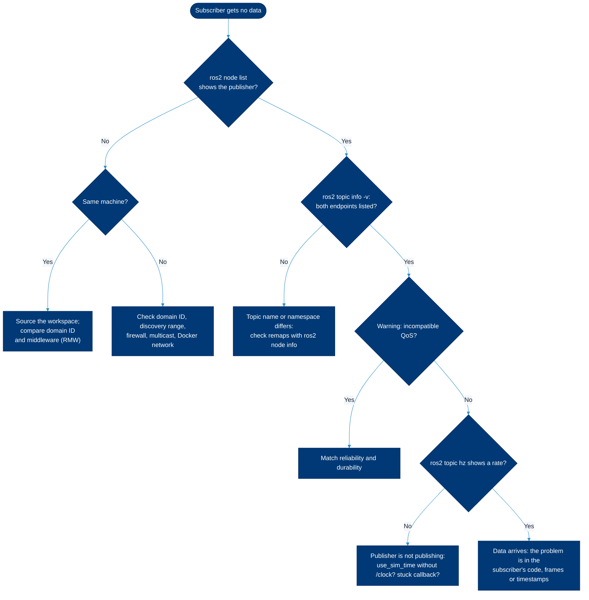

# Debugging ROS 2

> **Read this when** something does not work: nodes cannot see each other, a subscriber gets nothing, RViz shows transform errors, a build fails, or a node crashes or runs slowly.

Most ROS 2 problems fall into a handful of causes: the shell is not set up, two machines are not on the same ROS network, publisher and subscriber disagree on QoS, time or transforms are wrong, or dependencies are missing. This page goes from symptom to cause to fix, with the commands to prove each step. The one thing to remember: **check the environment first (`printenv | grep -E 'ROS|RMW'`), then look at the graph (`ros2 node list`, `ros2 topic info -v`), and only then read code.**

## Contents

- [First five checks](#first-five-checks)
- [Decision flow](#decision-flow)
- [Command not found or package not found](#command-not-found-or-package-not-found)
- [Nodes can't see each other](#nodes-cant-see-each-other)
- [QoS mismatch: subscriber receives nothing](#qos-mismatch-subscriber-receives-nothing)
- [Transform (tf) errors](#transform-tf-errors)
- [Time and use\_sim\_time](#time-and-use_sim_time)
- [Build failures and rosdep](#build-failures-and-rosdep)
- [Performance: slow, laggy or dropping messages](#performance-slow-laggy-or-dropping-messages)
- [Crashes and hangs](#crashes-and-hangs)
- [Record a bag to reproduce a problem](#record-a-bag-to-reproduce-a-problem)
- [ros2 doctor](#ros2-doctor)
- [Asking for help](#asking-for-help)
- [Related](#related)

## First five checks

- [ ] **Sourced?** `printenv ROS_DISTRO` prints your distro, and `ros2 pkg prefix <your_pkg>` finds your package.
- [ ] **Same distro and middleware everywhere?** Compare `printenv ROS_DISTRO RMW_IMPLEMENTATION` on every machine and container.
- [ ] **Same domain?** `printenv ROS_DOMAIN_ID` is identical on every machine (empty means 0).
- [ ] **Discovery not limited?** `ROS_AUTOMATIC_DISCOVERY_RANGE` is not `LOCALHOST` or `OFF` (Iron and newer), and `ROS_LOCALHOST_ONLY` is not `1` (Humble).
- [ ] **Does ROS itself work?** Run the [talker and listener](03-install-native.md#check-the-install) on one machine, then across two.

## Decision flow



## Command not found or package not found

| Symptom | Cause | Fix |
|---|---|---|
| `ros2: command not found` | This shell never sourced ROS | `source /opt/ros/<distro>/setup.bash`, and add it to `~/.bashrc` ([set up your shell](03-install-native.md#set-up-your-shell)) |
| `Package 'my_pkg' not found` | The workspace overlay is not sourced, or the package was not built | From the workspace root: `colcon build --packages-select my_pkg`, then `source install/setup.bash` |
| `No executable found` | New entry point or executable not rebuilt | Rebuild the package and source again; check `ros2 pkg executables my_pkg` |
| Your code changes have no effect | Built without `--symlink-install`, or you are running the underlay's copy | Rebuild; `ros2 pkg prefix my_pkg` should point into your workspace's `install/` |
| Strange import or library errors | Two distros sourced in one shell | Open a new terminal; check `~/.bashrc` sources only one distro |

## Nodes can't see each other

`ros2 node list` on machine B does not show nodes running on machine A (or in a container).

| Cause | How to tell | Fix |
|---|---|---|
| Different `ROS_DOMAIN_ID` | `printenv ROS_DOMAIN_ID` differs | Set the same number on both. We confirmed that containers on domains 7 and 8 do not see each other |
| Discovery limited to one machine | `ROS_AUTOMATIC_DISCOVERY_RANGE=LOCALHOST` (Iron and newer) or `ROS_LOCALHOST_ONLY=1` (Humble) | Unset it or set `SUBNET`. On Jazzy the old variable still works but prints a deprecation warning; on Kilted and Lyrical it is ignored |
| Different distros or RMWs | `printenv ROS_DISTRO RMW_IMPLEMENTATION` differ | Use one distro and one RMW for the whole system ([distributions](02-distributions.md#how-support-works-lts-and-non-lts)) |
| Multicast blocked | `ros2 multicast receive` on B never prints `Received from ...` when A runs `ros2 multicast send` | Use a network that allows multicast (many campus and guest Wi-Fi networks do not), or list peers with `ROS_STATIC_PEERS` (Iron and newer) or a middleware config file |
| Firewall | Works with the firewall off, fails with it on | Allow UDP from the robot's subnet, for example `sudo ufw allow from 192.168.1.0/24`, rather than disabling the firewall |
| Docker bridge network | The container has its own IP range and cannot reach the LAN's multicast | Start it with `--network host` on Linux; containers on the same user-defined Docker network do discover each other |
| Docker Desktop, WSL2 | macOS or Windows host | Host networking on Docker Desktop works at layer 4 only ([Docker docs](https://docs.docker.com/engine/network/drivers/host/)); on WSL2 use mirrored networking ([install notes](03-install-native.md#windows)); or work from a Linux machine |
| Stale `ros2` daemon | `ros2 node list` shows old nodes or misses new ones | `ros2 daemon stop`; the next `ros2` command starts a fresh one |
| Weak Wi-Fi | Discovery works but data stutters or drops | Use Ethernet or a dedicated access point for the robot; reduce image and point cloud rates ([performance](#performance-slow-laggy-or-dropping-messages)) |

Test the link between two machines with `ros2 doctor hello` on both, or run `ros2 run demo_nodes_cpp talker` on one and `ros2 run demo_nodes_py listener` on the other. The official guide [Run 2 nodes in single or separate docker containers](https://docs.ros.org/en/jazzy/How-To-Guides/Run-2-nodes-in-single-or-separate-docker-containers.html) covers containers.

> [!IMPORTANT]
> Several robots and people share the lab network. Use the domain ID assigned to your robot (`[lab domain ID assignments]`) so you never command someone else's robot by accident.

## QoS mismatch: subscriber receives nothing

The node graph looks right, but the subscriber's callback never runs. A common case: a sensor driver publishes **best effort** (the `sensor_data` profile) and your node subscribes **reliable**.

What you see (we reproduced this in `ros:jazzy`):

```console
[WARN] [...]: New publisher discovered on topic '/scan_test', offering incompatible QoS. No messages will be received from it. Last incompatible policy: RELIABILITY
```

How to confirm and fix:

```bash
ros2 topic info -v /scan        # compare "Reliability" and "Durability" of publisher and subscribers
ros2 topic echo --qos-reliability best_effort /scan   # the CLI can match the publisher
```

In your code, subscribe to sensor topics with the sensor-data profile (`rclpy.qos.qos_profile_sensor_data` in Python, `rclcpp::SensorDataQoS()` in C++). For latched data such as `/map` or `/robot_description`, the subscriber needs `transient_local` durability to receive the last message. Background: [QoS settings](https://docs.ros.org/en/jazzy/Concepts/Intermediate/About-Quality-of-Service-Settings.html).

## Transform (tf) errors

| Message or symptom | Cause | Fix |
|---|---|---|
| `Invalid frame ID "base_link" passed to canTransform argument target_frame - frame does not exist` | Nobody publishes that frame (yet), or its name is misspelled | `ros2 run tf2_tools view_frames` and read the PDF; check `robot_state_publisher` is running and the URDF names match |
| `Lookup would require extrapolation into the future` or `into the past` | Timestamps disagree: clocks out of sync between machines, or a mix of sim and wall time | Sync clocks with NTP or chrony; make every node agree on `use_sim_time` |
| RViz: `No transform from [laser] to [map]` | The tree is broken between those frames | `ros2 run tf2_ros tf2_echo map laser`; find the missing link in `view_frames` |
| Robot jumps or drifts in RViz | Two nodes publish the same transform, or odometry is wrong | `view_frames` shows each frame's broadcaster; remove the duplicate |

Commands we ran in `ros:jazzy`:

```bash
ros2 run tf2_tools view_frames              # writes frames_<date>.pdf and .gv in the current folder
ros2 run tf2_ros tf2_echo base_link camera_link
ros2 run rqt_tf_tree rqt_tf_tree            # GUI; not run in our headless check
```

Official guide: [debugging tf2 problems](https://docs.ros.org/en/jazzy/Tutorials/Intermediate/Tf2/Debugging-Tf2-Problems.html).

## Time and use\_sim\_time

In simulation or bag replay, nodes should read time from the `/clock` topic instead of the computer clock. That is what the `use_sim_time` parameter does.

| Symptom | Cause | Fix |
|---|---|---|
| A node with `use_sim_time:=true` publishes nothing, and timers never fire | Nothing publishes `/clock`, so ROS time stays at zero. The [ROS 2 time design](https://design.ros2.org/articles/clock_and_time.html) says a time of zero means time is uninitialized. We saw it: in 4 seconds our talker sent no messages with `use_sim_time:=true` and seven without it | Start the simulator (it publishes `/clock`) or play the bag with `ros2 bag play <bag> --clock` |
| tf extrapolation errors only in simulation | Some nodes use sim time, some wall time | Set `use_sim_time` the same on every node, usually from the launch file |
| Check one node | | `ros2 param get /<node> use_sim_time` (Lyrical: `ros2 param get use_sim_time` asks every node) |

## Build failures and rosdep

| Symptom | Cause | Fix |
|---|---|---|
| `Could not find a package configuration file provided by "X"` (CMake) or `ModuleNotFoundError` in tests | A dependency is not installed | `rosdep install --from-paths src --ignore-src -y`, and make sure `package.xml` lists it |
| `rosdep install` says `Cannot locate rosdep definition for [X]` | The key is misspelled, not in rosdistro for your distro, or the database is stale | `rosdep update`; check the name on [ROS Index](https://index.ros.org/) |
| `ERROR: no sources directory exists on the system meaning rosdep has not yet been initialized` | First use on this machine | `sudo rosdep init`, then `rosdep update` |
| Errors mention another distro's paths (`/opt/ros/humble/...` on Jazzy) | Old `build/` and `install/` from another distro, or two distros sourced | `rm -rf build install log` and rebuild in a clean shell |
| Build killed or machine freezes | Out of memory while compiling C++ | `colcon build --parallel-workers 1` (or `--executor sequential`), or add swap |
| `externally-managed-environment` from `pip` | Ubuntu 24.04 and newer protect the system Python | Use the apt package (`python3-<name>`) through rosdep, or a virtual environment |
| Test failures with no detail | You only ran `colcon test` | `colcon test-result --verbose` |

Show compiler output as it happens with `colcon build --event-handlers console_direct+`, and read full logs in `log/latest_build/<package>/`.

## Performance: slow, laggy or dropping messages

| Check | Command | What to look for |
|---|---|---|
| Actual publish rate | `ros2 topic hz /<topic>` | Lower than expected means the publisher or network is the bottleneck |
| Bandwidth | `ros2 topic bw /<topic>` | Raw camera images and point clouds can use tens of MB/s; Wi-Fi will not keep up |
| Message age | `ros2 topic delay /<topic>` | Growing delay means someone is falling behind (needs a header stamp) |
| CPU and memory | `top` or `htop` | One process at 100% of a core is a single-threaded bottleneck |
| Callback blocking | Add timing logs, or run with `--log-level debug` | A slow callback in a single-threaded executor delays every other callback in that node |

Common fixes: publish compressed images (`image_transport` plugins), lower sensor rates, keep heavy processing on the robot and send results rather than raw data, set QoS depth to what you need, and build C++ with optimization (`--cmake-args -DCMAKE_BUILD_TYPE=Release`). Middleware tuning is covered in the official [DDS tuning guide](https://docs.ros.org/en/jazzy/How-To-Guides/DDS-tuning.html).

## Crashes and hangs

**Read the log first.** Every node logs to the terminal and to `~/.ros/log/` (or `$ROS_LOG_DIR`). Turn up the detail for one node:

```bash
ros2 run my_pkg my_node --ros-args --log-level debug
ros2 run my_pkg my_node --ros-args --log-level my_node:=DEBUG   # only this node's logger
```

**Get a backtrace from a C++ crash** (the official [backtrace guide](https://docs.ros.org/en/jazzy/How-To-Guides/Getting-Backtraces-in-ROS-2.html)):

```bash
sudo apt install gdb
colcon build --packages-select my_pkg --cmake-args -DCMAKE_BUILD_TYPE=RelWithDebInfo
ros2 run --prefix 'gdb -ex run --args' my_pkg my_node
# after the crash, type: bt
```

In a launch file, add `prefix=['gdb -ex run --args']` to one `Node(...)`, or wrap every node with `ros2 launch --launch-prefix 'xterm -e gdb -ex run --args' my_pkg my.launch.py`.

**Keep a core dump** for crashes you cannot reproduce under gdb:

```bash
ulimit -c unlimited                 # this shell only
cat /proc/sys/kernel/core_pattern   # shows where (or to which program) the system sends core files
```

**Python nodes:** the traceback is in the log. For a hang, `py-spy dump --pid <pid>` shows where every thread is stuck (install `py-spy` in a virtual environment; it is not part of ROS).

> [!NOTE]
> When you stop a launch file with Ctrl-C, a Python node can print a `KeyboardInterrupt` traceback while it shuts down, because it receives the interrupt from both the terminal and `ros2 launch`. We saw this with the official demo pattern on Humble and Jazzy. It is harmless if the launch log ends with the process exiting.

## Record a bag to reproduce a problem

A bag lets someone else replay exactly what your robot saw.

```bash
# Jazzy and newer
ros2 bag record -o bug_2026-09-30 --topics /scan /odom /tf /tf_static /cmd_vel
# Humble
ros2 bag record -o bug_2026-09-30 /scan /odom /tf /tf_static /cmd_vel
# Everything (large!)
ros2 bag record -o bug_all -a
```

Then check and share it: `ros2 bag info bug_2026-09-30`, and replay with `ros2 bag play bug_2026-09-30 --clock` while the other nodes run with `use_sim_time:=true`. Include `/tf_static` and `/tf`, or nobody can interpret the data. Store large bags in `[lab shared storage location]`, not in Git.

## ros2 doctor

`ros2 doctor` checks the platform, network interfaces, middleware and topics, and warns about common problems such as a publisher without subscribers. In our `ros:jazzy` run it ended with `All 5 checks passed`.

```bash
ros2 doctor                   # summary
ros2 doctor --report          # full report: versions, network, RMW, topics
ros2 doctor --report-failed   # only what failed
ros2 doctor hello             # run on two machines to test that they can hear each other
```

On Lyrical, `--report` also lists actions, services and ROS environment variables ([Lyrical release notes](https://docs.ros.org/en/lyrical/Releases/Release-Lyrical-Luth.html)).

## Asking for help

Give people what they need to help you:

- [ ] What you ran (exact commands), what you expected and what happened (full error text, not a screenshot).
- [ ] `ros2 doctor --report` from the machines involved.
- [ ] `printenv | grep -E 'ROS|RMW'` from each machine.
- [ ] A small bag or the smallest code that shows the problem.

Where to ask: the lab's `[Slack channel]`, then [Robotics Stack Exchange](https://robotics.stackexchange.com/) (tag `ros2` and your distro) and [ROS Discourse](https://discourse.openrobotics.org/) ([resources](09-resources.md)).

## Related

- [Command cheatsheet](05-cheatsheet.md)
- [What is ROS 2](01-what-is-ros2.md#discovery-and-ros_domain_id): discovery and QoS explained
- [Lab robots](08-lab-robots.md): robot-specific networking
- Official: [installation troubleshooting](https://docs.ros.org/en/lyrical/Get-Started/Installation/Installation-Troubleshooting.html), [logging](https://docs.ros.org/en/jazzy/Concepts/Intermediate/About-Logging.html)

<sub>Last reviewed: Sept. 30, 2026 · Sources checked on that date · [Suggest a change](https://github.com/ATR-Lab/all-things-ros2/edit/main/docs/07-debugging.md)</sub>
